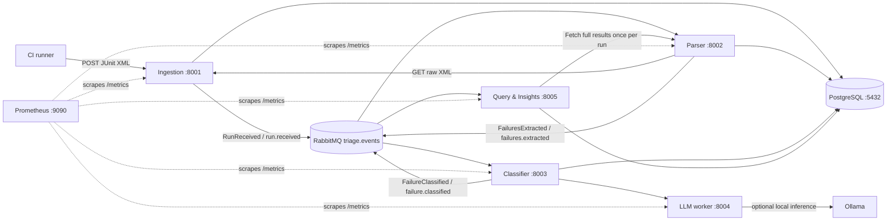

# CI-Triage-Platform

[](https://github.com/AayushShetty01/CI-Triage-Platform/actions/workflows/ci.yml)

CI Test-Failure Triage Platform is an event-driven distributed system that
automates CI test analysis. It uses FastAPI, RabbitMQ, PostgreSQL, and a local
LLM to ingest JUnit reports, classify recurring failures, detect flaky tests,
and provide actionable insights through APIs and dashboards.

## Architecture and service ownership



| Service | Port | Owns / consumes | Produces / calls |
|---|---:|---|---|
| Ingestion | 8001 | Upload API, raw report storage, transactional outbox | Publishes `RunReceived`; Parser reads raw XML through its internal API |
| Parser | 8002 | Parses JUnit XML and owns test-result history; consumes `run.received` | Publishes `FailuresExtracted`; fetches raw XML from Ingestion using `INGESTION_BASE_URL` |
| Classifier | 8003 | Rules, fingerprints, classification records; consumes `failures.extracted` | Publishes `FailureClassified`; queues optional local LLM work |
| Classifier LLM worker | 8004 | Claims classifier LLM jobs | Calls Ollama at `OLLAMA_BASE_URL`; it is not required when `LLM_ENABLED=false` |
| Query & Insights | 8005 | Dashboard and query-owned read projection; consumes all three events | Fetches Parser results at event-processing time using `PARSER_BASE_URL`; serves run, insight, and flakiness APIs |

All business services use the `triage` PostgreSQL database with separate
roles, schemas, and Alembic version tables (`ingestion`, `parser`,
`classifier`, and `query`). RabbitMQ carries events on the durable
`triage.events` topic exchange. Prometheus scrapes all four APIs and the
separate Classifier worker; `/health` and `/metrics` are available on every
service.

## Event contracts and idempotency

The shared event envelope contains `event_id` (UUID), `event_type`,
`occurred_at`, `schema_version` (`"1.0"`), `run_id` (64-character SHA-256),
and `payload`. Producer-owned JSON Schemas and samples are in
[`contracts/events/`](contracts/events/); see the
[contract notes](contracts/README.md).

| Event | Producer → routing key → consumer | Idempotency |
|---|---|---|
| `RunReceived` | Ingestion → `run.received` → Parser and Query | `run_id` is derived from commit SHA and report bytes; Parser stores one parsed run and Query records `event_id` plus unique `(run_id, test_id)` rows |
| `FailuresExtracted` | Parser → `failures.extracted` → Classifier and Query | Stable run-level processing in Parser; Classifier and Query deduplicate event IDs and enforce unique run/test rows |
| `FailureClassified` | Classifier → `failure.classified` → Query | Event-ID deduplication plus Query's unique `(run_id, test_id)` projection |

Outbox relays provide at-least-once delivery, not exactly-once delivery.
Consumers must tolerate duplicates. Query copies Parser's test history into its
own schema once when handling `FailuresExtracted`; flaky-test reads do not call
Parser. **Week 10 ADR:** Query owns the history/flakiness projection so insights
remain available if Parser is unavailable. The rejected alternative was to
call Parser from Query at read time, coupling dashboard availability and
latency to Parser. Details are in
[ADR-004](docs/adr/ADR-004-query-history-projection.md).

## Run locally and test

For the full local stack, copy `.env.example` to `.env` and run:

```bash
docker compose up -d --build
```

This starts the local Ollama service and pulls the configured model. To run
the API pipeline without model download or LLM calls:

```bash
LLM_ENABLED=false docker compose up -d --build \
  postgres rabbitmq parser classifier query ingestion prometheus
python tools/e2e_smoke.py
```

Run each service's unit and contract tests with its development requirements:

```bash
mkdir -p reports
python -m pip install -r services/ingestion/requirements-dev.txt
python -m pytest -c services/ingestion/pytest.ini services/ingestion/tests \
  --junitxml=reports/ingestion.xml
python -m pip install -r services/parser/requirements-dev.txt
python -m pytest -c services/parser/pytest.ini services/parser/tests \
  --junitxml=reports/parser.xml
python -m pip install -r services/classifier/requirements-dev.txt
python -m pytest -c services/classifier/pytest.ini services/classifier/tests \
  --junitxml=reports/classifier.xml
python -m pip install -r services/query/requirements-dev.txt
python -m pytest -c services/query/pytest.ini services/query/tests \
  --junitxml=reports/query.xml
```

Tests use PostgreSQL, not SQLite. Point `DATABASE_URL` at a dedicated,
disposable PostgreSQL database; the service fixtures reset only their own
schemas. Ingestion's PostgreSQL/RabbitMQ integration tests additionally use
`INGESTION_TEST_DATABASE_URL` and `INGESTION_TEST_RABBITMQ_URL`. CI provisions
both databases and RabbitMQ service containers. The `/reports/` output folder
is ignored by Git.

## CI self-triage

The [`ci.yml`](.github/workflows/ci.yml) workflow runs on pushes, pull requests,
and manual dispatch:

1. A four-service matrix runs unit, contract, and Ingestion integration tests
   against PostgreSQL (and RabbitMQ where required), then uploads a JUnit XML
   artifact for each service.
2. The E2E job starts a clean Compose stack with `docker compose up --wait`,
   publishes a failing sample through the full pipeline, and checks
   idempotency and unsafe/malformed report rejection.
3. The non-blocking publish job restores the ephemeral Postgres history,
   publishes every JUnit artifact to Ingestion, and waits for Parser,
   Classifier, and Query projections.
4. The dashboard job exports Query's JSON data and creates a portable HTML
   snapshot and PNG screenshot. Download the `dashboard-snapshot` artifact
   from the workflow run.

The runner-local Compose stack is ephemeral. A branch-scoped Actions cache
stores a Postgres dump and restores it on the next run so trend and flakiness
history can accumulate without hosting a public service. Runs on different
branches intentionally have separate history. Publishing and snapshot jobs
are non-blocking for the test verdict.

Set the repository Actions secret `TRIAGE_INGESTION_API_KEY` to the key accepted
by the local Compose Ingestion service. Without it, JUnit publishing is skipped
with a notice; the test and E2E verdicts still run. The optional
`workflow_dispatch` input `run_failure_simulation` publishes simulated failing
and pass/fail flaky-test reports to demonstrate Query triage.

## Ingestion

[](https://github.com/AayushShetty01/CI-Triage-Platform/actions/workflows/ingestion-failure-tests.yml)

Ingestion accepts JUnit XML reports up to `MAX_REPORT_SIZE_BYTES` (10 MiB by
default), stores each run and its `RunReceived` event in PostgreSQL in one
transaction, and relays events asynchronously to RabbitMQ. Duplicate
submissions with the same commit SHA and report bytes return the existing
`run_id`. The transaction and API behavior are implemented in
[`main.py`](services/ingestion/app/main.py), with the database schema in
[`database.py`](services/ingestion/app/database.py); relay behavior is in
[`relay.py`](services/ingestion/app/relay.py).

### Start the local service

Use Docker Compose and Python 3.11 for the local test tools:

```bash
cp .env.example .env
docker compose up -d --build
```

Ingestion listens on port `8001`. The supported endpoints are:

- `POST /runs`: upload a raw XML report (`application/xml`, `text/xml`, or
  `application/junit+xml`) or a multipart form with `file`/`report`,
  `commit_sha`, and `branch`.
- `GET /internal/runs/{run_id}/raw`: retrieve the original uploaded XML bytes.
- `GET /health`: health response.
- `GET /metrics`: Prometheus metrics.

For raw XML, submit required metadata and authentication headers:

```bash
curl -X POST http://localhost:8001/runs \
  -H 'Content-Type: application/xml' \
  -H 'X-API-Key: dev-ingestion-key-change-me' \
  -H 'X-Commit-Sha: 0123456789abcdef' \
  -H 'X-Branch: main' \
  --data-binary @junit.xml
```

`POST /runs` requires `X-API-Key`, matching `INGESTION_API_KEY`.
`GET /internal/runs/{run_id}/raw` requires `X-Internal-Key`, matching
`INTERNAL_API_KEY`. The Parser service must send `X-Internal-Key` and read
`INGESTION_BASE_URL` and `INTERNAL_API_KEY` from its configuration. `/health`
and `/metrics` remain open so health checks and Prometheus can access them.

Authentication is deliberately minimal (static shared keys), not a production
design. Development values are defined in `.env.example` and Compose; configure
non-development values outside local development.
The authentication and Compose environment settings are defined in
[`main.py`](services/ingestion/app/main.py) and
[`.env.example`](.env.example).

### Configuration, events, and logs

The relevant settings are:

- `DATABASE_URL` and `RABBITMQ_URL` (Compose builds these from its credentials)
- `INGESTION_API_KEY` and `INTERNAL_API_KEY`
- `MAX_REPORT_SIZE_BYTES`
- `OUTBOX_POLL_INTERVAL_SECONDS`, `RELAY_POLL_INTERVAL_SECONDS`,
  `RELAY_BACKOFF_CAP_SECONDS`, and `OUTBOX_BATCH_SIZE`
- `INGESTION_RETRY_AFTER_SECONDS`
- `INGESTION_BASE_URL` for the Parser's Ingestion endpoint

The relay publishes persistent messages to the durable `triage.events` topic
exchange with publisher confirms. It marks an outbox row published only after
the broker confirms. Delivery is at least once: a retry can redeliver the same
event, so consumers should be idempotent and use the stable `event_id`.
Ingestion logs are JSON lines with request IDs and run/event IDs when known.
API keys, request bodies, and XML are not logged.

The application metrics include `ingest_requests_total`,
`ingest_latency_seconds`, `ingest_auth_failures_total`, `outbox_pending`,
`outbox_oldest_pending_seconds`, `relay_publish_errors_total`, and
`relay_consecutive_failures`. The oldest-pending gauge is zero when no
unpublished outbox row remains. Metric definitions are in
[`main.py`](services/ingestion/app/main.py); the relay refreshes outbox gauges
in [`relay.py`](services/ingestion/app/relay.py).

### Tests

Install development dependencies:

```bash
python -m pip install -r services/ingestion/requirements-dev.txt
```

Run the default unit and integration test suite:

```bash
python -m pytest -c services/ingestion/pytest.ini services/ingestion/tests
```

The tests named `test_contracts.py` validate the shared schema, samples,
producer output, relay transformation, negative cases, and—when the configured
integration services are available—a message received from RabbitMQ:

```bash
python -m pytest -c services/ingestion/pytest.ini \
  services/ingestion/tests/test_contracts.py -q
```

The test cases are in
[`test_contracts.py`](services/ingestion/tests/test_contracts.py) and the
other Ingestion tests are under
[`services/ingestion/tests/`](services/ingestion/tests/).

The optional controlled simulation uses a mock payment application to produce
a sample JUnit report; it does not stop or fault the real Compose services:

```bash
python -m pytest -c services/ingestion/pytest.ini \
  services/ingestion/failure_simulation/test_ingestion_failures.py
```

Its results are available from the `CI Triage` workflow's
`run_failure_simulation` dispatch option.

The real failure-injection suite is marked `failure` and excluded from the
default run. It stops, starts, or kills Docker Compose services and always
attempts to restore the stack:

```bash
make failure-tests
```

It exercises broker/database outages, crash recovery, in-flight uploads,
broker flapping, and concurrent duplicate submissions. Scenario summaries,
timestamped service logs, and drained messages are written under
`services/ingestion/failure_simulation/evidence/`; generated folders are
ignored by Git except for the committed `example/` reference. See the
[Ingestion runbook](docs/runbook/ingestion.md) and
[mutation results](services/ingestion/failure_simulation/MUTATION_CHECK.md).

Run the 50-request load smoke:

```bash
make load-test
```

Reproduce the full measured matrix (the broker-down run stops and restores
RabbitMQ during measurement):

```bash
python tools/load/ingestion_load.py --requests 500 --concurrency 1 --report-size small --label small-concurrency-1 --output-dir docs/evidence/ingestion-load
python tools/load/ingestion_load.py --requests 500 --concurrency 5 --report-size small --label small-concurrency-5 --output-dir docs/evidence/ingestion-load
python tools/load/ingestion_load.py --requests 500 --concurrency 20 --report-size small --label small-concurrency-20 --output-dir docs/evidence/ingestion-load
python tools/load/ingestion_load.py --requests 500 --concurrency 50 --report-size small --label small-concurrency-50 --output-dir docs/evidence/ingestion-load
python tools/load/ingestion_load.py --requests 500 --concurrency 20 --report-size small --label small-concurrency-20-repeat-1 --output-dir docs/evidence/ingestion-load
python tools/load/ingestion_load.py --requests 500 --concurrency 20 --report-size small --label small-concurrency-20-repeat-2 --output-dir docs/evidence/ingestion-load
python tools/load/ingestion_load.py --requests 500 --concurrency 20 --report-size small --label small-concurrency-20-repeat-3 --output-dir docs/evidence/ingestion-load
python tools/load/ingestion_load.py --requests 100 --concurrency 5 --report-size large --label large-concurrency-5 --output-dir docs/evidence/ingestion-load
python tools/load/ingestion_load.py --requests 100 --concurrency 20 --report-size large --label large-concurrency-20 --output-dir docs/evidence/ingestion-load
python tools/load/ingestion_load.py --requests 500 --concurrency 20 --report-size small --label small-broker-down-concurrency-20 --output-dir docs/evidence/ingestion-load --broker-down
```

For the full load commands and saved measurements, see
[`docs/evidence/ingestion-load/SUMMARY.md`](docs/evidence/ingestion-load/SUMMARY.md).
Those results are from one laptop and are not production capacity figures.

The `RunReceived` event contract is owned by Ingestion. See the
[schema](contracts/events/run_received.schema.json),
[consumer samples](contracts/events/samples/), and
[contract documentation](contracts/README.md). Optional CI provenance is
carried as `payload.ci` (`repository`, `workflow`, external CI run ID and
attempt, service, actor, run URL, and timestamp); the event version remains
`"1.0"`, and the content-derived `run_id` format is unchanged.

## Parser

Parser is an event-driven consumer service that processes incoming test runs. It consumes
`RunReceived` events from RabbitMQ (`triage.events` topic exchange, routing key `run.received`),
fetches the raw JUnit XML report from Ingestion's internal endpoint (`GET /internal/runs/{run_id}/raw`)
using `INTERNAL_API_KEY`, parses the XML safely with `defusedxml`, stores test execution history,
and emits a `FailuresExtracted` event for the Classifier service.

### Key Characteristics

- **Idempotency**: Enforces idempotency on `(run_id, test_id)` via a unique constraint in PostgreSQL.
  Duplicate `RunReceived` deliveries are detected and ignored without duplicate processing or rows.
- **Transactional Outbox**: Emitted `FailuresExtracted` events are written to the `parser.outbox` table
  in the same database transaction as the parsed results. A background relay publishes confirmed events
  to RabbitMQ, ensuring zero message loss across broker restarts.
- **Poison Message & DLQ Handling**: Malformed JSON or corrupted XML reports are rejected without
  requeue, routing them to the Dead Letter Queue (`parser.run_received.dlq`) via `triage.dlx`.
  Transient network or database failures are retried with exponential backoff.
- **Safe Parsing**: Uses `defusedxml` to protect against XML entity expansion (billion laughs) and XXE attacks.

### Endpoints

Parser runs on port `8002`:

- `GET /health`: Health status and database connectivity check.
- `GET /metrics`: Prometheus metrics (`parser_events_consumed_total`, `parser_events_processed_total`,
  `parser_tests_total`, `parser_failures_extracted_total`, `parser_outbox_pending`, etc.).
- `GET /runs/{run_id}`: Parsed run metadata and summary counts.
- `GET /runs/{run_id}/results`: List of all test cases parsed for the run.
- `GET /runs/{run_id}/failures`: Extracted failures and error details for the run.

### Testing and Verification

#### 1. End-to-End Verification (Live Stack)

Start the full stack with Docker Compose:

```bash
cp .env.example .env
docker compose up -d --build
```

Submit a sample JUnit report containing a test failure to Ingestion (`POST /runs`):

```bash
curl -s -X POST http://localhost:8001/runs \
  -H "Content-Type: application/xml" \
  -H "X-API-Key: dev-ingestion-key-change-me" \
  -H "X-Commit-Sha: 0123456789abcdef" \
  -H "X-Branch: main" \
  -d "<testsuite name='checkout' tests='2' failures='1'><testcase classname='payments.CheckoutTests' name='rejects_expired_card' time='0.42'><failure message='expected HTTP 402, got 200' type='AssertionError'>AssertionError: expected HTTP 402, got 200</failure></testcase><testcase classname='payments.CheckoutTests' name='accepts_valid_card' time='0.15'/></testsuite>"
```

Ingestion replies `202 Accepted` with a `run_id`, writes the outbox event, and publishes `RunReceived` to RabbitMQ. The Parser automatically consumes the event, retrieves the report XML, parses it, and emits `FailuresExtracted`.

Inspect the parsed results directly from Parser:

```bash
# 1. Parsed run summary (counts, commit, status)
curl http://localhost:8002/runs/<run_id>

# 2. Extracted failure details
curl http://localhost:8002/runs/<run_id>/failures

# 3. Complete list of all test results
curl http://localhost:8002/runs/<run_id>/results

# 4. Parser Prometheus metrics
curl http://localhost:8002/metrics
```

You can also inspect the RabbitMQ queues (`parser.run_received`, `parser.run_received.dlq`) and exchanges in the RabbitMQ UI at **http://localhost:15672** (username: `triage`, password: `triage_dev`).

#### 2. Instant Local CLI Demo (No Docker required)

A standalone demonstration script runs the complete pipeline in memory using SQLite:

```bash
python tools/demo_pipeline.py
```

This verifies XML parsing, database persistence, `FailuresExtracted` outbox payload generation, and duplicate message idempotency.

#### 3. Automated Test Suite

Run the full Parser test suite (unit tests, XML security/fuzz tests, contracts, consumer, DLQ poison-handling, relay):

```bash
python -m pytest -c services/parser/pytest.ini services/parser/tests/ -v
```

The `FailuresExtracted` event contract is owned by Parser. See the
[schema](contracts/events/failures_extracted.schema.json) and
[sample](contracts/events/samples/failures_extracted.json).


## Classifier

Classifier consumes `FailuresExtracted` (queue `classifier.failures_extracted`,
routing key `failures.extracted`), classifies each failed test, and publishes one
`FailureClassified` event per failure (routing key `failure.classified`) through
its own transactional outbox. Categories are `assertion`, `timeout`,
`infrastructure`, `flaky`, and `unknown`.

### How a failure is classified

1. **Fingerprint.** The error type, the message with volatile tokens (numbers,
   ids, UUIDs, IPs, quoted values) replaced, and the innermost stack frame are
   hashed. Failures with the same fingerprint form a group (`GET /groups`).
   See [`fingerprint.py`](services/classifier/app/fingerprint.py).
2. **Rules first.** An ordered rule list ([`rules.py`](services/classifier/app/rules.py))
   handles the common cases immediately (`source=rule`). Failures with no type,
   message or stack are `unknown` without an LLM call.
3. **LLM fallback.** Anything left becomes a job in `classifier.llm_jobs`, keyed by
   `(fingerprint, model, prompt_version)`. The consumer never calls the LLM; it
   only queues work and records the failure as `pending`.
4. **Worker pool.** The `classifier-llm-worker` container claims jobs
   (`FOR UPDATE SKIP LOCKED` with a lease, so a crashed worker's job is
   reclaimed), calls Ollama behind a circuit breaker, and finishes every pending
   failure attached to the job in one transaction (`source=llm`).
5. **Cache.** A finished job answers later failures with the same fingerprint
   without calling the model (`source=llm_cache`). One LLM call covers a whole group.

### Reliability and degradation

- LLM timeouts or errors are retried with exponential backoff up to
  `LLM_MAX_ATTEMPTS`; after that the failures are marked **degraded**
  (`category=unknown`, `source=fallback`) and an event is still published.
- After `BREAKER_FAILURE_THRESHOLD` consecutive failures the breaker opens and no
  calls are made for `BREAKER_RESET_SECONDS`; one trial call then decides whether
  it closes. Jobs that wait longer than `LLM_DEGRADE_AFTER_SECONDS` while the LLM
  is failing are degraded, so nothing stays pending indefinitely. A job that is
  merely queued behind others with a healthy LLM is not degraded.
- A degraded fingerprint gets a fresh LLM attempt the next time it occurs.
- `LLM_ENABLED=false` runs rules only; unmatched failures are degraded.
- Duplicate `FailuresExtracted` deliveries are ignored (`processed_events` and
  a unique `(run_id, test_id)`). Malformed messages go to
  `classifier.failures_extracted.dlq`.
- The relay uses `on_return_raises`, so an event with no bound consumer queue
  stays in the outbox and is retried rather than being confirmed and dropped.

### LLM safety, determinism, and versioning

- Test logs are untrusted. They are stripped of control characters and of our
  delimiter tokens, truncated (`LLM_MAX_INPUT_CHARS`), and placed inside fixed
  delimiters the system prompt marks as data. Instruction-like text is counted
  (`classifier_llm_prompt_injection_suspected_total`) and still only classified.
- The model has no tools. Its reply is constrained with a JSON schema in the
  Ollama request and validated again; only a value from the category list is
  used. Invalid output becomes `unknown`.
- `temperature=0`, a fixed seed, and a prompt with no per-call randomness.
- Every classification stores `rules_version`, `model`, `prompt_version`, and
  `prompt_hash`. Changing the model or prompt version creates new jobs instead of
  reusing old results.
- Cost is visible in `classifier_llm_tokens_total` and
  `classifier_llm_latency_seconds`; grouping and the cache limit the calls made.

### Running it

The Compose stack adds `classifier` (port `8003`: API, consumer, relay),
`classifier-llm-worker` (port `8004`), `ollama`, and a one-shot `ollama-pull`
that downloads `OLLAMA_MODEL` (default `qwen2.5:1.5b`, about 1 GB) into a volume.

```bash
docker compose up -d --build
```

To use Ollama installed on your machine instead of the container (no image or
model download if the model is already pulled), point the services at the host
and skip the `ollama` dependency. First make sure the host Ollama server is
running (`curl http://localhost:11434/api/tags`); start it with `ollama serve`
if needed. Then run:

```bash
ollama pull qwen2.5:1.5b
export OLLAMA_BASE_URL=http://host.docker.internal:11434 OLLAMA_MODEL=qwen2.5:1.5b
docker compose up -d --build postgres rabbitmq query ingestion parser classifier
docker compose up -d --no-deps classifier-llm-worker
```

The model tag in `OLLAMA_MODEL` must match one shown by `ollama list`. This host
mode does not start the Compose `ollama` container, so it also avoids a port
11434 conflict with the host installation.

The Postgres init scripts run only on a new volume. If your `postgres_data`
volume predates the classifier, create its role and schema once (or recreate the
volume with `docker compose down -v`, which deletes all local data):

```bash
docker compose exec postgres sh /docker-entrypoint-initdb.d/30-classifier.sh
```

Endpoints:

- `GET /runs/{run_id}/classifications`: per-failure results and status counts
  (`pending`, `classified`, `degraded`).
- `GET /groups`: failure groups, most frequent first, with the latest category.
- `GET /llm/status`: model, prompt and rules versions, job counts, and (on the
  worker, port `8004`) the circuit breaker state.
- `GET /health`, `GET /metrics`.

Run the tests against a dedicated PostgreSQL database; the fake Ollama
transport is used in LLM tests:

```bash
python -m pip install -r services/classifier/requirements-dev.txt
cd services/classifier && python -m pytest -c pytest.ini tests
```

## Query & Insights

Query is the fourth independently deployable business service. It consumes
`RunReceived`, `FailuresExtracted`, and `FailureClassified` from RabbitMQ into
its own PostgreSQL schema. It displays per-run and aggregate pass/fail/skipped
counts, branch/commit history, classifier category and confidence, classifier
source, failure-signature groups, per-service breakdowns, GitHub Actions links,
and potentially flaky tests. The dashboard uses the Query API, not static
sample data. Query reads complete per-run test outcomes through the Parser API
when it handles `FailuresExtracted`, then owns that history projection for
subsequent insight requests.

The pipeline can consume these JSON endpoints:

- `GET /api/runs?days=90&limit=200`: recent runs with test counts and optional
  CI metadata.
- `GET /api/runs/{run_id}`: one run and its classified failures, confidence,
  source, and fingerprint.
- `GET /api/insights?days=90`: aggregate test counts, categories, recurring
  fingerprints, and service breakdown.
- `GET /api/services?days=90`: service-level counts and categorized failures.
- `GET /api/flaky?days=90`: Query-owned history candidates with both pass and
  fail/error outcomes in distinct runs.

Each successful CI workflow exports a self-contained HTML dashboard, JSON
data, and PNG screenshot as the `dashboard-snapshot` artifact. The workflow
summary links to the artifact; the screenshot below is added after a real
GitHub Actions run.

Start the full stack with `docker compose up -d --build`, wait for
`http://localhost:8005/health` to return 200, and open the UI at
`http://localhost:8005`. The Query API runs on port 8005. Prometheus is at
`http://localhost:9090` and the provisioned Grafana dashboard at
`http://localhost:3000`. See the [Query runbook](docs/runbook/query.md) for
demonstration and failure recovery steps, and
[ADR-004](docs/adr/ADR-004-query-history-projection.md) for the ownership and
consistency trade-off.

Run Query tests without Docker after installing its development requirements:

```bash
python -m pip install -r services/query/requirements-dev.txt
cd services/query && python -m pytest -c pytest.ini -q
```
